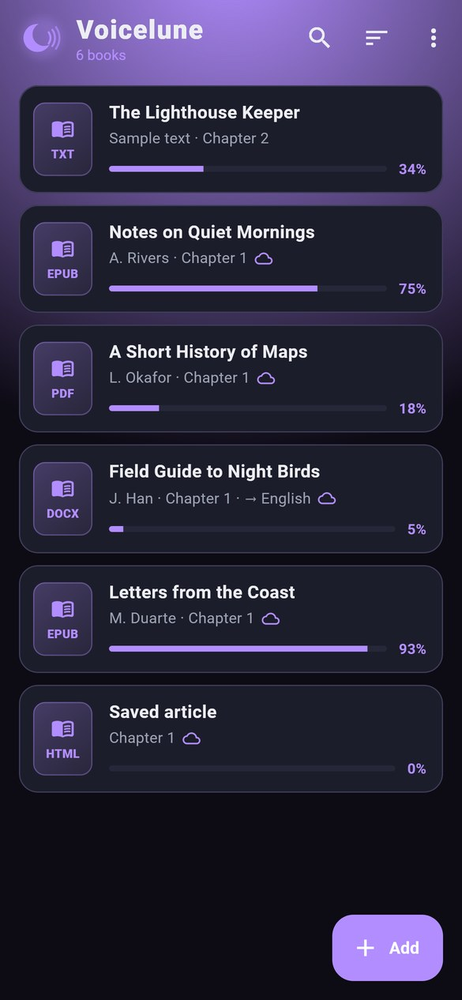
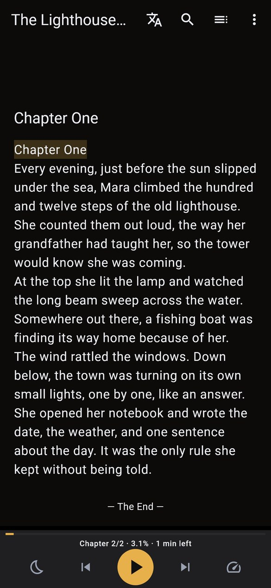
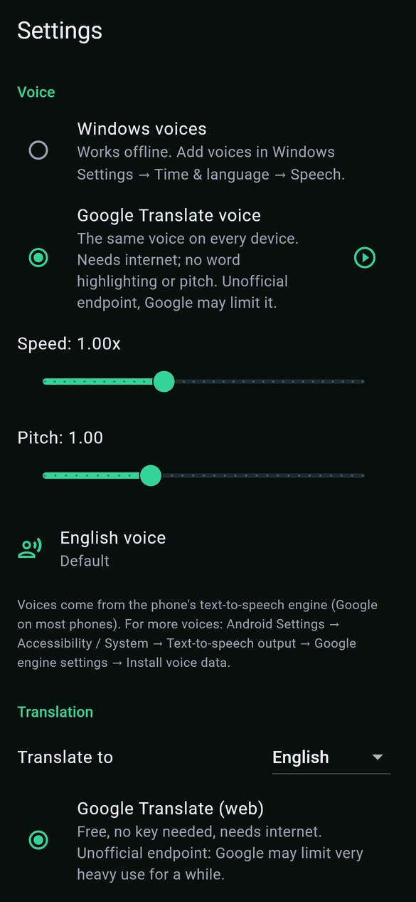
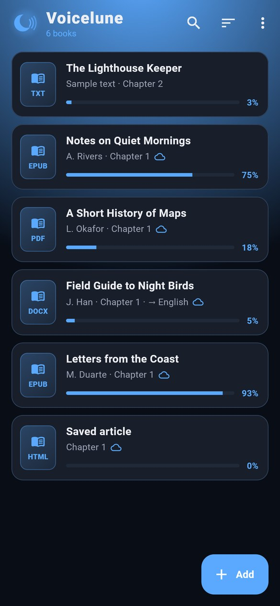
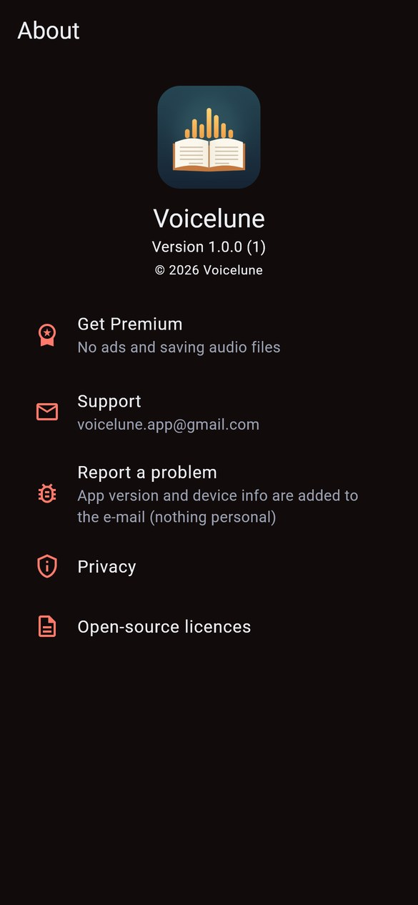

# Voicelune: Read Aloud Books

Reads your books aloud on Android and Windows, and can translate them as it reads.

[Türkçe](#türkçe) · [Privacy policy](privacy.md)

  
  
  
  
  

Library · Reading aloud · Voices and translation · Themes · About

## Download

- **Windows:** [Releases](../../releases/latest). Download `Voicelune-Windows.zip`, extract it anywhere and run `Voicelune.exe`.
- **Android:** coming to Google Play.

## Features

- EPUB, PDF (with text), DOCX, ODT, MOBI, TXT, HTML, web pages and pasted text.
- Reads sentence by sentence and highlights the spoken line and word. Tap a sentence to read from there.
- Device voices (Windows voices on a PC), or the Google voice.
- Translates while it reads: on-device on Android, or with Google, DeepL or an AI provider using your own key.
- Speed, pitch, sleep timer, bookmarks, and controls from the notification, lock screen or headphones.
- Saves chapters as audio files (WAV, M4A, MP3).
- Syncs books, positions, bookmarks and translations through the app's private Google Drive area.
- Dark themes in several accent colours, English and Turkish.

## Support

voicelune.app@gmail.com

This repository holds the downloads and documentation only; the source code is not published here.

---

## Türkçe

Kitaplarınızı Android ve Windows'ta sesli okur, isterseniz okurken çevirir.

[Gizlilik politikası](privacy.md#türkçe)

Ekran görüntüleri (yukarıda): Kitaplık · Sesli okuma · Sesler ve çeviri · Temalar · Hakkında

### İndir

- **Windows:** [Sürümler](../../releases/latest). `Voicelune-Windows.zip` dosyasını indirip istediğiniz yere çıkarın ve `Voicelune.exe`'yi çalıştırın.
- **Android:** yakında Google Play'de.

### Özellikler

- EPUB, PDF (metinli), DOCX, ODT, MOBI, TXT, HTML, web sayfası ve yapıştırılan metin.
- Cümle cümle okur, okunan satırı ve kelimeyi işaretler. Bir cümleye dokununca oradan okur.
- Cihazın sesleri (bilgisayarda Windows sesleri) ya da Google sesi.
- Okurken çeviri: Android'de cihazda, ya da kendi anahtarınızla Google, DeepL veya bir AI sağlayıcısı.
- Hız, ton, uyku zamanlayıcısı, yer imleri; bildirimden, kilit ekranından ve kulaklıktan kontrol.
- Bölümleri ses dosyası olarak kaydeder (WAV, M4A, MP3).
- Kitapları, kaldığınız yerleri, yer imlerini ve çevirileri Google Drive'daki uygulamaya özel gizli alan üzerinden senkronlar.
- Farklı vurgu renklerinde koyu temalar, Türkçe ve İngilizce.

### Destek

voicelune.app@gmail.com

Bu depoda yalnızca indirmeler ve belgeler bulunur; kaynak kod burada yayımlanmaz.
